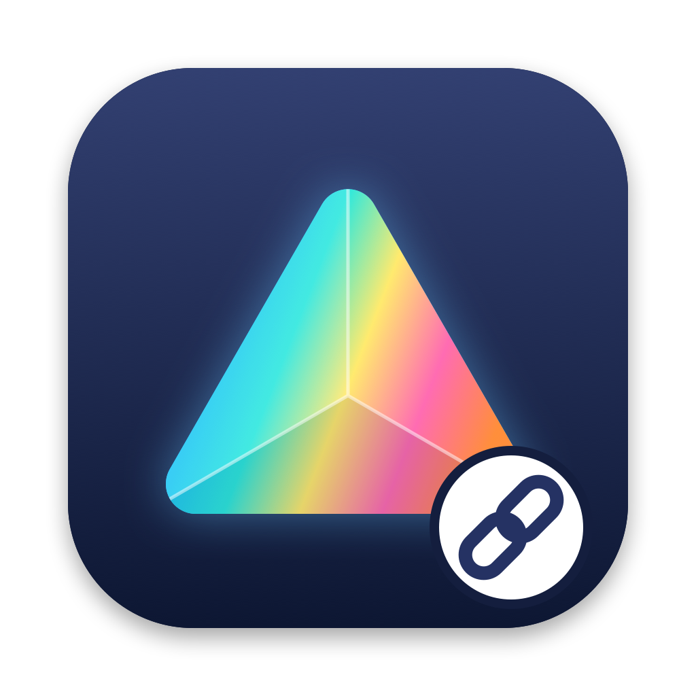

<p align="center"></p>

# PrismLink

GraphPad Prism grafiklerini macOS'ta PowerPoint'e bağlayan menü çubuğu uygulaması. Windows'taki "grafiğe çift tıkla, Prism açılsın" (OLE) davranışını Mac'te sağlar.

> PrismLink bağımsız bir projedir; GraphPad Software veya Microsoft ile bağlantısı yoktur. Prism ve PowerPoint kendi sahiplerinin ticari markalarıdır.

## Nasıl çalışır

1. Prism'de grafiği **Cmd+C** ile kopyala.
2. PowerPoint'e **Cmd+V** ile yapıştır. Grafik açık olan Prism projesine otomatik bağlanır.
3. PowerPoint'te grafiğe **çift tıkla**. Proje Prism'de açılır.
4. Grafiği değiştirdiysen Prism'de yeniden kopyala, PowerPoint'te eski grafiği seç ve menü çubuğundan **Seçili grafiği panodakiyle güncelle** seçeneğini kullan.

Prism'e veya PowerPoint'e hiçbir eklenti kurulmaz. Şekle yalnızca bir kimlik yazılır; proje konumu ve yedek kopya `~/Library/Application Support/PrismLink` altında tutulur.

## Kurulum

1. [Releases](../../releases) sayfasından `PrismLink.dmg` dosyasını indir.
2. PrismLink'i **Applications** klasörüne sürükle ve oradan aç.
3. macOS uygulamayı engellerse **System Settings → Privacy & Security** sayfasının altındaki **Open Anyway** düğmesini kullan.
4. Uygulamanın gösterdiği pencereden macOS iznini ver:

| macOS | İznin yeri |
|---|---|
| 27 ve üzeri | Privacy & Security → **Device Control and Data Access** (kenar çubuğundaki Accessibility değil) |
| 26 ve altı | Privacy & Security → **Accessibility** |

5. İlk kullanımda çıkan PowerPoint erişim isteğini onayla.

## Sınırlamalar

- Bağlantılar yalnızca grafiği bağlayan Mac'te çalışır; sunumu başka bir Mac'e taşırsan proje bilgisi gitmez.
- Proje açılır ama belirli grafik sayfasına gidilmez.
- Windows'ta gömülmüş eski OLE nesnelerini açmaz.
- Proje en az bir kez kaydedilmiş olmalıdır.
- Yapıştırma Cmd+V ile yapılmadıysa menüden **Seçili grafiği açık Prism projesine bağla** seçeneğini kullan.
- Şu an yalnızca Apple Silicon Mac'ler için derlenir.

## Kaynaktan derleme

Xcode Komut Satırı Araçları gerekir.

```bash
./build.sh
```

Çıktı `dist/PrismLink.dmg` dosyasıdır. İkon `Tools/make_icon.swift` ile üretilir.

## Lisans

[MIT](LICENSE)
